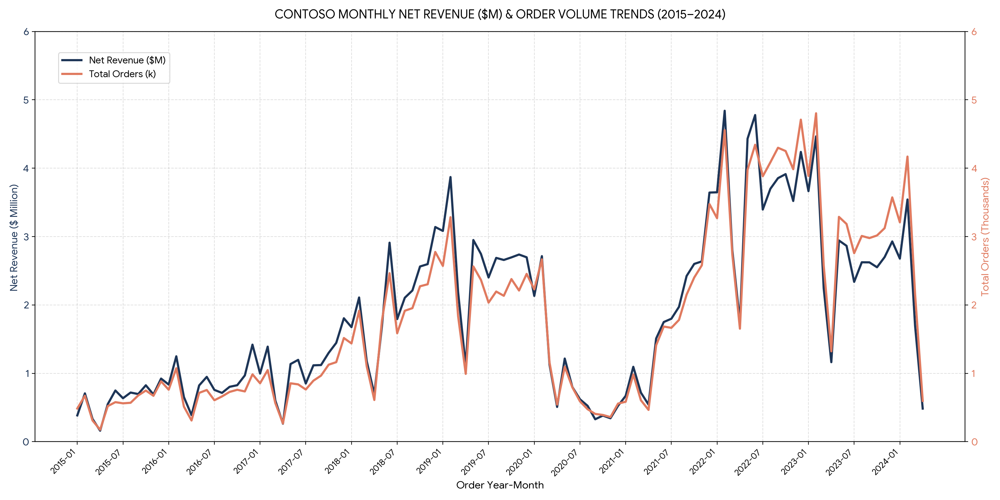
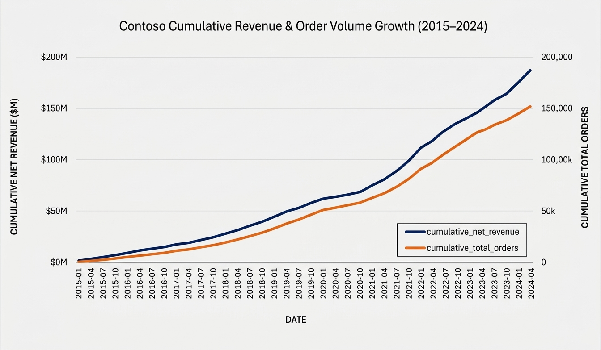
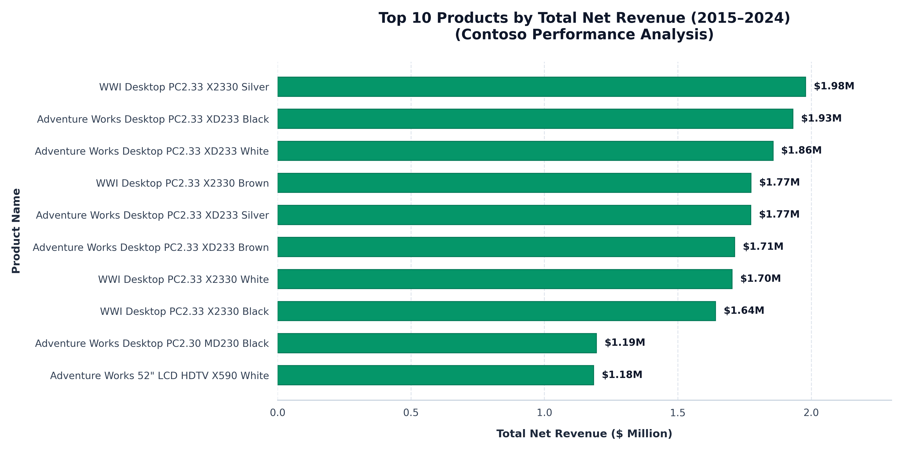
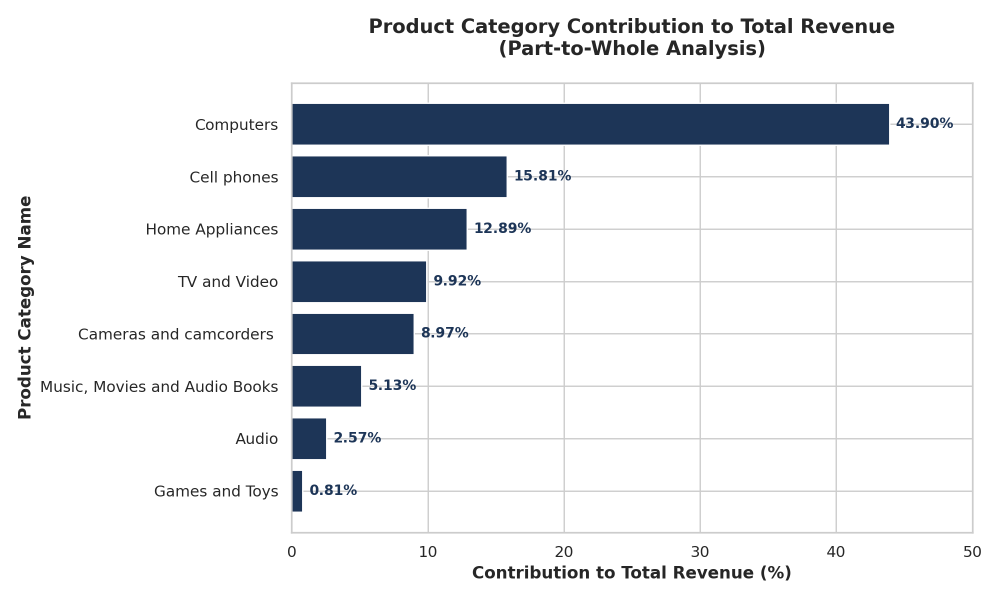
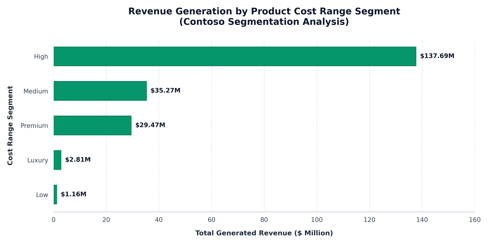
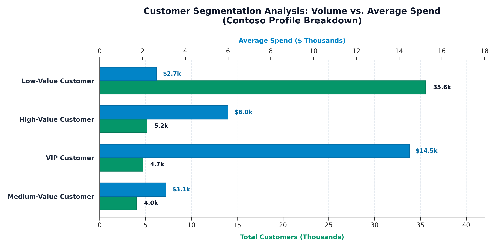

# 📊 **Contoso Retail Analytics: End-to-End Enterprise SQL Project**

[](https://www.linkedin.com/in/mohammed-elkhamlichi/)
[](https://github.com/Mohammed-Elkhamlichi)
[](https://www.postgresql.org/)
[](https://www.postgresql.org/docs/current/tutorial-window.html)
[](./DATA/datasets/contoso_100k.sql)

## 📌 _Executive Summary_

This repository contains a comprehensive **8-Phase Enterprise Data Analytics Solution** built on the **Contoso 100K Retail Dataset**. The primary goal of this project is to transform raw relational transactional data into actionable executive insights, business performance metrics, customer behavior segmentation, and production-ready database views.

Designed with modularity and production engineering standards in mind, the analytical pipeline handles over **100,000 transactions** using advanced PostgreSQL techniques including Multi-Tier CTEs, Window Functions, dynamic thresholding, and zero-division handling.

---

## 🛠️ _Tech Stack & Key SQL Techniques_

- **Database Management System:** PostgreSQL
- **SQL Techniques:** Multi-Tier CTEs, Dynamic Window Functions (`OVER ()`), Aggregations, Date Math Arithmetic, Safe Division (`CASE`), Data Sanitation (`COALESCE`, `ROUND`).
- **BI & Reporting Tooling:** Prepared for direct connection to **Power BI** and **Microsoft Excel** via production database views.

---

## 📁 _Repository & Project Architecture_

```text
Contoso_Retail_Analytics_With_SQL/
├── ASSETS/
│   └── graphs/
│       ├── 1_change_over_time_graph.png
│       ├── 2_cumulative_analysis_graph.png
│       ├── 3_product_performance_graph.png
│       ├── 4_part_to_whole_analysis_graph.png
│       ├── 5_products_segmentation_graph.png
│       └── 6_customers_segmentation_graph.png
├── DATA/
│   ├── datasets/
│   │   └── contoso_100k.sql
│   └── exports/
│       ├── 1_change_over_time_output.csv
│       ├── 2_cumulative_analysis_output.csv
│       ├── 3_product_performance_output.csv
│       ├── 4_part_to_whole_output.csv
│       ├── 5_products_segmentation_output.csv
│       ├── 6_customers_segmentation_output.csv
│       ├── 7_customer_report_view_output.csv
│       └── 8_product_report_view_output.csv
├── SQL/
│   ├── 1_change_over_time.sql
│   ├── 2_cumulative_analysis.sql
│   ├── 3_product_performance.sql
│   ├── 4_part_to_whole_analysis.sql
│   ├── 5_products_segmentation.sql
│   ├── 6_customers_segmentation.sql
│   ├── 7_customer_report_view.sql
│   └── 8_product_report_view.sql
├── .gitignore
└── README.md
```

## 🔹 _1. Change Over Time Analysis_

### _Objective:_

Analyzes temporal trajectory and seasonality trends across yearly, aggregated monthly, and continuous Year-Month time-series scales.

📜 **SQL Script:** [`SQL/1_change_over_time.sql`](SQL/1_change_over_time.sql)

💾 **Exported Data:** [`DATA/exports/1_change_over_time_output.csv`](DATA/exports/1_change_over_time_output.csv)



#### Analytical Findings

- **Early Growth Phase (2015–2017):** Monthly net revenue steadily climbed from under $500K toward consistent $1M–$1.8M ranges, with strong year-end holiday peaks in December.

- **Rapid Expansion (2018–2019):** Significant scaling pushed monthly revenues past $2M–$3.8M, accompanied by a major jump in order volume.

- **Post-2020 Peak Performance:** Marked by substantial spikes throughout 2022 and 2023, where monthly net revenue frequently exceeded $4M and order volumes peaked near 4,800 orders per month.

---

## 🔹 _2. Cumulative Analysis_

### _Objective:_

Tracks chronological business expansion and cumulative volume accumulation over time using SQL window functions.

📜 **SQL Script:** [`SQL/2_cumulative_analysis.sql`](SQL/2_cumulative_analysis.sql)

💾 **Exported Data:** [`DATA/exports/2_cumulative_analysis_output.csv`](DATA/exports/2_cumulative_analysis_output.csv)



#### Analytical Findings

**Milestone Achievements ($100M & $200M Net Revenue):**

- $100M Lifetime Revenue: Reached in February 2021 ($100,444,683 across 88,256 total cumulative orders).

- $200M Lifetime Revenue: Reached in January 2024 ($200,688,516 across 192,951 total cumulative orders).

- Final Revenue Base (Apr 2024): Closed at $206,407,545 across 199,873 cumulative orders.

**Expansion Velocity Trajectory:**

- 2015 – 2019 Growth Phase: Steep constant upward slope, driving the company from $1M to $87.4M cumulative revenue in 5 years.

- 2020 Growth Plateau: The curve flattened significantly throughout 2020 due to macro contraction, taking 12 months to add under $11M in cumulative revenue.

- 2021 – 2023 Acceleration Phase: Resumed rapid upward scaling, adding over $100M in revenue in under 3 years.

---

## 🔹 _3. Product Performance Analysis_

### _Objective:_

Evaluates yearly product-level net revenue variance relative to multi-year product historical averages and tracks Year-over-Year (YoY) performance shifts.

📜 **SQL Script:** [`SQL/3_product_performance.sql`](SQL/3_product_performance.sql)

💾 **Exported Data:** [`DATA/exports/3_product_performance_output.csv`](DATA/exports/3_product_performance_output.csv)



#### Analytical Findings

**1. Macro Revenue Expansion & Volatility Trajectory
Peak Revenue Year (2022):**

- Total net revenue reached an all-time peak of $44,864,557 in 2022 (accounting for 21.7% of the cumulative $206.4M 10-year revenue), driven by 2,102 products outperforming their multi-year historical average.

**Contraction Years (2020 & 2023–2024):**

- In 2020, revenue dropped to $11.2M, with 1,726 products (86%) experiencing a YoY revenue decline due to macroeconomic contraction.

- In 2024 (partial data), 1,875 products lagged below their multi-year benchmark.

**2. Product Performance Tiering & Portfolio Skew
Long-Tail Product Distribution:**

- Across all 22,052 annual records, 59.5% (13,127 records) were categorized as Below Average relative to their multi-year benchmark, while 40.4% (8,911 records) qualified as Above Average.

- High Concentration of Elite Performers: Top-tier revenue is heavily concentrated in high-end Desktop hardware (e.g., WWI Desktop PC2.33 X2330 Silver with $1.98M lifetime revenue).

- Top 10 Contribution: The top 10 individual products generated $16.75M, representing 8.1% of total portfolio net revenue across the 10-year window.

---

## 🔹 _4. Part-to-Whole Analysis_

### _Objective:_

Measures structural portfolio reliance and revenue contribution per product category relative to overall business revenue.

📜 **SQL Script:** [`SQL/4_part_to_whole_analysis.sql`](SQL/4_part_to_whole_analysis.sql)

💾 **Exported Data:** [`DATA/exports/4_part_to_whole_output.csv`](DATA/exports/4_part_to_whole_output.csv)



#### Analytical Findings

- Computers lead all sales categories, representing nearly half (43.90%) of total revenue.

- Cell phones and Home Appliances form the strong secondary revenue tier, combining for 28.70%.
  <br>
  <br>
  <br>

---

## 🔹 _5. Products Segmentation_

### _Objective:_

Categorizes inventory into standardized pricing bands based on standard product cost and measures financial yield by pricing tier.

📜 **SQL Script:** [`SQL/5_products_segmentation.sql`](SQL/5_products_segmentation.sql)

💾 **Exported Data:** [`DATA/exports/5_products_segmentation_output.csv`](DATA/exports/5_products_segmentation_output.csv)



#### Analytical Findings

- **High-Cost Dominance:** The High cost-range segment is the primary engine of revenue generation, producing $137.69M across 76,621 products.

- **Mid-Tier & Premium Performance:** Medium cost-range products generated $35.27M, closely followed by Premium products at $29.47M. Luxury ($2.81M) and Low ($1.16M) cost tiers capture smaller, highly specialized or volume-fringe segments.

---

## 🔹 _6. Customers Segmentation_

### _Objective:_

Profiles buyer behavior using lifetime spend, customer lifespan (tenure in months), and baseline portfolio spend metrics.

📜 **SQL Script:** [`SQL/6_customers_segmentation.sql`](SQL/6_customers_segmentation.sql)

💾 **Exported Data:** [`DATA/exports/6_customers_segmentation_output.csv`](DATA/exports/6_customers_segmentation_output.csv)



#### Analytical Findings

- **Volume Distribution:** The Low-Value Customer tier forms the vast majority of the customer base with 35,575 customers (approx. 72.8% of total profile volume), whereas VIP Customers (4,711), High-Value Customers (5,161), and Medium-Value Customers (4,040) represent a high-value engaged core.

- **Spend vs. Volume Trade-off:** While Low-Value customers drive sheer transaction volume, VIP Customers command the highest average spend tier at $14,480, followed by High-Value customers at $6,004, Medium-Value at $3,093, and Low-Value at $2,662.

---

## 🔹 _7. Customer Report View_

### _Objective:_

Encapsulates end-to-end customer metrics, activity recency, age demographics, and spending tiers into a persistent database view.

📜 **SQL Script:** [`SQL/7_customer_report_view.sql`](SQL/7_customer_report_view.sql)

💾 **Exported Data:** [`DATA/exports/7_customer_report_view_output.csv`](DATA/exports/7_customer_report_view_output.csv)

---

## 🔹 _8. Product Report View_

### _Objective:_

Consolidates product performance KPIs, lifecycle metrics, recency tracking, financial efficiency (AOR, monthly revenue), and catalog revenue tiering into a persistent database view.

📜 **SQL Script:** [`SQL/8_product_report_view.sql`](SQL/8_product_report_view.sql)

💾 **Exported Data:** [`DATA/exports/8_product_report_view_output.csv`](DATA/exports/8_product_report_view_output.csv)
<br>
<br>

---

## 🔌 _Business Intelligence & Power BI / Excel Integration_

**These database views eliminate redundant data preparation in reporting tools:**

- **Live DirectQuery Connection:** Power BI / Excel connects directly to vw_customer_report and vw_product_report.

- **Centralized Business Logic:** All calculations (recency thresholds, revenue formulas, zero-handling) are maintained at the database level.

- **Automated Refreshing:** As new sales records are inserted into PostgreSQL, connected dashboards update automatically.

---

# Developer Setup Guide & Database Documentation

Welcome to the project! This guide will help you set up your local development environment, restore the **Contoso 100K** database schema, and understand the core data model.

---

## 🛠️ Prerequisites

Before you begin, ensure you have installed:

- **Git**
- **PostgreSQL** (version 14 or higher recommended)
- **pgAdmin 4** (optional, recommended for GUI users)

---

## 🚀 Quick Start Guide

### Step 1: Download or Locate `contoso_100k.sql`

Ensure the file `contoso_100k.sql` is downloaded into your local directory (e.g., your `Downloads` folder or working directory).

---

### Step 2: Create the `contoso_100k` Database

Open your terminal (or Command Prompt) and connect to PostgreSQL:

```bash
psql -U postgres
```

Inside the `psql` interactive prompt, run:

```sql
CREATE DATABASE contoso_100k;
\q
```

---

### Step 3: Restore the Database (`contoso_100k.sql`)

Choose **Method A** (Terminal) or **Method B** (pgAdmin / `psql` Interactive):

#### Method A: Command Line (Quickest)

Run the following command from your terminal inside the folder containing `contoso_100k.sql`:

```bash
psql -U postgres -d contoso_100k -f contoso_100k.sql
```

_Or using shell input redirection:_

```bash
psql -U postgres -d contoso_100k < contoso_100k.sql
```

#### Method B: Inside pgAdmin / PSQL Console

1. Connect to the `contoso_100k` database:
    ```bash
    psql -U postgres -d contoso_100k
    ```
2. Execute the import command (`\i`) with the full path to your SQL file:
    ```sql
    \i '/path/to/your/contoso_100k.sql'
    ```
    _(On Windows, example: `\i 'C:/Users/YourName/Downloads/contoso_100k.sql'`)_

---

### Step 4: Verify the Database Setup

Check that all tables were created properly by connecting and listing the tables:

```sql
psql -U postgres -d contoso_100k
```

Run this inside `psql`:

```sql
\dt
```

You should see 6 main tables created: `sales`, `customer`, `product`, `store`, `date`, and `currencyexchange`.

---

## 📊 Database Schema Overview

The `contoso_100k` database is a standard star schema dataset for retail analytics:

| Table Name             | Description                                | Key Columns                                                      |
| :--------------------- | :----------------------------------------- | :--------------------------------------------------------------- |
| **`sales`**            | Fact table containing transaction logs     | `orderkey`, `customerkey`, `storekey`, `productkey`, `orderdate` |
| **`customer`**         | Customer demographic & profile data        | `customerkey`, `name`, `city`, `country`                         |
| **`product`**          | Catalog details, hierarchy, & prices       | `productkey`, `productname`, `category`, `subcategory`           |
| **`store`**            | Retail store metadata & locations          | `storekey`, `storename`, `country`                               |
| **`date`**             | Date dimension for time-series aggregation | `date`, `datekey`, `year`, `quarter`                             |
| **`currencyexchange`** | Daily historical currency exchange rates   | `date`, `fromcurrency`, `tocurrency`, `exchange_rate`            |

---

## 💡 Quick Query Test

Test your setup by executing this query:

```sql
SELECT
    p.categoryname,
    SUM(s.quantity * s.netprice) AS total_revenue
FROM sales s
LEFT JOIN product p ON s.productkey = p.productkey
GROUP BY p.categoryname
ORDER BY total_revenue DESC;
```

---

## 👨‍💻 _Author & Contact_

**Mohammed EL KHAMLICHI**  
_Junior Data Analyst_

- 📂 **GitHub:** [Mohammed ELKHAMLICHI](https://github.com/Mohammed-Elkhamlichi)
- 💼 **LinkedIn:** [Mohammed ELKHAMLICHI](https://www.linkedin.com/in/mohammed-elkhamlichi/)
