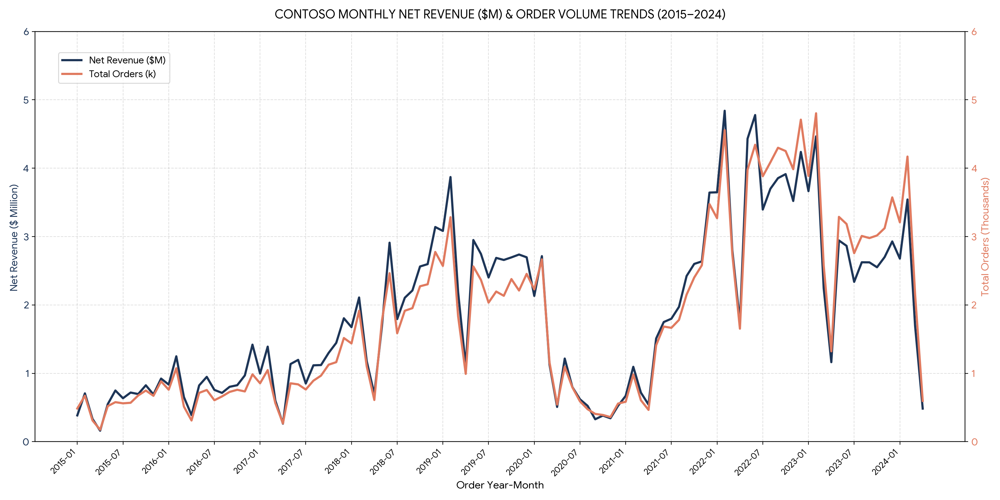

# Contoso Retail Analytics With SQL:

Contoso_Retail_Analytics_With_SQL/  
├── ASSETS/  
│ ├── graphs/  
│ │ ├── 1_year_month_trend.png  
│ │ ├── 2_cumulative_analysis.png  
│ │ └── 3_performance_analysis.png  
│ └── ERD_Diagram.png  
├── DATA/  
│ ├── raw/  
│ │ └── contoso_100k.sql  
│ └── exports/  
│ ├── 1_year_month_trend.csv  
│ ├── 2_cumulative_analysis.csv  
│ └── 3_performance_analysis.csv  
├── SQL/  
│ ├── 1_change_over_time.sql  
│ ├── 2_cumulative_analysis.sql  
│ ├── 3_performance_analysis.sql  
│ ├── 4_part_to_whole.sql  
│ ├── 5_data_segmentation.sql  
│ └── 6_executive_reports.sql  
├── .gitignore  
└── README.md  

## **📈 1. Change Over Time Analysis**

### Year-Month Revenue Trend

Tracks monthly financial growth and sales volume from 2015 to 2024.

- **SQL Script:** [`SQL/1_change_over_time.sql`](SQL/1_change_over_time.sql)
- **Exported Data:** [`DATA/exports/1_change_over_time.csv`](DATA/exports/1_change_over_time.csv)

#### Analytical Findings

- **Early Growth Phase (2015–2017):** Monthly net revenue steadily climbed from under $500K toward consistent $1M–$1.8M ranges, with strong year-end holiday peaks in December.

- **Rapid Expansion (2018–2019):** Significant scaling pushed monthly revenues past $2M–$3.8M, accompanied by a major jump in order volume.

- **Post-2020 Peak Performance:** Marked by substantial spikes throughout 2022 and 2023, where monthly net revenue frequently exceeded $4M and order volumes peaked near 4,800 orders per month.

# **2. Cumulative Analysis**

Tracks monthly financial growth and sales volume from 2015 to 2024.

- **SQL Script:** [`SQL/2_cumulative_analysis.sql`](SQL/2_cumulative_analysis.sql)
- **Exported Data:** [`DATA/exports/2_cumulative_analysis.csv`](DATA/exports/1_change_over_time.csv)

#### Analytical Findings

**Milestone Achievements ($100M & $200M Net Revenue):**

- $100M Lifetime Revenue: Reached in February 2021 ($100,444,683 across 88,256 total cumulative orders).

- $200M Lifetime Revenue: Reached in January 2024 ($200,688,516 across 192,951 total cumulative orders).

- Final Revenue Base (Apr 2024): Closed at $206,407,545 across 199,873 cumulative orders.

**Expansion Velocity Trajectory:**

- 2015 – 2019 Growth Phase: Steep constant upward slope, driving the company from $1M to $87.4M cumulative revenue in 5 years.

- 2020 Growth Plateau: The curve flattened significantly throughout 2020 due to macro contraction, taking 12 months to add under $11M in cumulative revenue.

- 2021 – 2023 Acceleration Phase: Resumed rapid upward scaling, adding over $100M in revenue in under 3 years.

## 3. Performance Analysis

#### + Comparing current metric values against historical targets, averages, or previous periods.

#### + Executing Year-over-Year (YoY) and Month-over-Month (MoM) comparative evaluations with conditional status flags.

## 4. Part-to-Whole Analysis

#### + Evaluating the proportional contribution of individual categories relative to the overall global total.

#### + Identifying dominant revenue drivers versus minor or underperforming category segments.

## 5. Data Segmentation

#### + Converting continuous numerical measures into brand-new dimensional categories using conditional logic.

#### + Establishing behavioral customer tiers (VIP, Regular, New) based on historical lifespan and total spending.

#### + Grouping product items into defined cost and revenue performance ranges.

## 6. Executive Reporting Views

#### + Consolidating core metrics, key performance indicators (KPIs), and behavioral segments into unified datasets.

#### + Creating modular database views (CREATE VIEW) to streamline consumption for business stakeholders and visualization tools.
